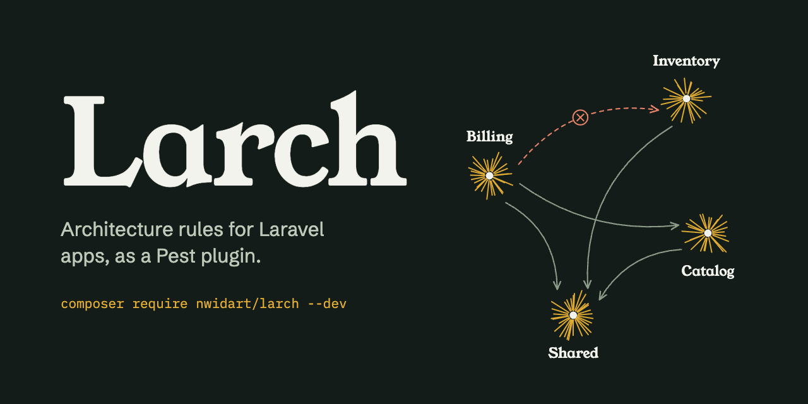

# Larch



Architecture rules for Laravel apps, as a Pest plugin. Larch checks which module uses which, and prints every link that breaks a rule with the file and line it comes from.

Larch reads links from the code, and from the booted app: facades, container keys, event listeners and dispatched jobs. Import-based tools cannot see those.

Larch is in early development.

## Install

```bash
composer require nwidart/larch --dev
```

Larch needs PHP 8.3 or later and Pest 4.3 or later.

## Example

Name the modules once, in `tests/Pest.php`:

```php
use function Nwidart\Larch\larch;

larch()
    ->modules('Modules\*')
    ->publicApi('Contracts', 'Events');
```

Then write rules:

```php
use Nwidart\Larch\Edge;

use function Nwidart\Larch\module;
use function Nwidart\Larch\modules;

arch('billing uses only shared, and the public API of catalog')
    ->expect(module('Billing'))
    ->toOnlyDependOn(module('Shared'), module('Catalog')->publicApi())
    ->via(Edge::all());

arch('no module is in a cycle')
    ->expect(modules())
    ->toHaveNoCycles();
```

A failure names each link that breaks the rule:

```
  Modules/Billing/app/Actions/ChargeOrder.php:16
    Modules\Billing\Actions\ChargeOrder uses Modules\Catalog\Pricing\PriceEngine
    It is internal to Catalog. The public API of a module is: Contracts, Events.
```

## Documentation

Read the full documentation at **[nwidart.github.io/larch](https://nwidart.github.io/larch/)**:

- [Getting started](https://nwidart.github.io/larch/getting-started/)
- Guides: [module boundaries](https://nwidart.github.io/larch/guides/module-boundaries/), [runtime links](https://nwidart.github.io/larch/guides/runtime-links/), [app rules](https://nwidart.github.io/larch/guides/app-rules/), [baseline](https://nwidart.github.io/larch/guides/baseline/), [graph export](https://nwidart.github.io/larch/guides/graph-export/), [Mortise](https://nwidart.github.io/larch/guides/mortise/)
- [Reference](https://nwidart.github.io/larch/reference/module-rules/): every rule, subject, link kind and option

## License

MIT. See [LICENSE.md](LICENSE.md).
